# mcquant: a validated Monte Carlo engine for derivatives pricing, portfolio risk and company valuation

[](https://github.com/karlOrdinario/mcquant/actions/workflows/ci.yml)


`mcquant` prices options, measures portfolio risk and values companies by simulation. Version 1.1 adds a full investment-banking valuation of **Monde Nissin (PSE: MONDE)**: a DCF built from public filings, a Monte Carlo DCF, trading comps, a football field, a live Excel model and an accretion/dilution module. See [Company valuation](#company-valuation-monde-nissin).

The engine also checks its own answers: every Monte Carlo price in the test suite is compared against an independent exact formula, binomial tree or characteristic-function integral, and must land within 4 standard errors.

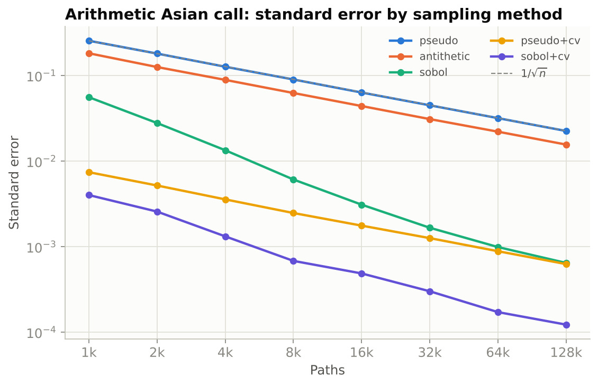

## Highlights

| | |
|---|---|
| **Models** | Black-Scholes GBM (exact scheme), Heston stochastic volatility (full-truncation Euler), Merton jump-diffusion (exact scheme) |
| **Contracts** | European, arithmetic and geometric Asian, all 8 single-barrier types, digital, American/Bermudan |
| **American options** | Longstaff-Schwartz least-squares Monte Carlo, with an out-of-sample estimator that gives a true lower bound |
| **Variance reduction** | Antithetic variates, control variates, randomised Sobol quasi-Monte Carlo with a Brownian-bridge path construction |
| **Greeks** | Pathwise, likelihood-ratio, and finite differences with common random numbers |
| **Risk** | Monte Carlo VaR/CVaR with full revaluation of option positions, normal vs fat-tailed (Student-t) shocks, delta-normal and historical VaR, stress tests |
| **Backtesting** | Rolling VaR forecasts with the Kupiec, Christoffersen and Basel traffic-light tests across 5 VaR models |
| **Valuation** | FCFF DCF, CAPM/WACC, Gordon and exit-multiple terminal values, equity bridge, Monte Carlo DCF with correlated drivers, tornado, sensitivity table, trading comps, football field, reverse DCF, Excel export with live formulas, accretion/dilution |
| **Dashboard** | Streamlit app with 7 tabs, including a one-click self-validation suite and a live valuation tab |

### Results (all reproducible with `python scripts/run_benchmarks.py`)

- **33,700x variance reduction** on an arithmetic Asian call (52 fixings, 131k paths) by combining randomised Sobol QMC with a geometric-Asian control variate. Even after paying for the extra compute per path, it reaches the same accuracy more than 7,000x faster (timing-based, so the exact figure varies by run and machine).
- **13 of 13 validation benchmarks pass**, with the largest error at 1.96 standard errors.
- **Longstaff-Schwartz matches a 2,500-step binomial tree** on the 20-case grid from Longstaff & Schwartz (2001), with a mean absolute difference of $0.007.
- **Heston Monte Carlo reproduces the semi-analytic volatility skew** within 15 basis points of implied vol for strikes from 70 to 130.
- **Delta-normal VaR understates a short-straddle book's risk 4.4x** compared with full-revaluation Monte Carlo, and by 6.4x once fat tails are included.
- **About 50 million path-steps per second** on a laptop-class CPU, and roughly 12x faster than the same Asian-option pricer written as a pure-Python loop.

## Quick start

```bash
git clone https://github.com/karlOrdinario/mcquant.git
cd mcquant
pip install -e ".[dev]"

pytest                                   # 299 tests, about 2 minutes
streamlit run app/streamlit_app.py       # dashboard at http://localhost:8501
python scripts/run_benchmarks.py         # regenerate figures and docs/results.json
```

## Company valuation: Monde Nissin

> **Not investment advice.** A learning project built only on public information and stated assumptions. The probability below is conditional on those assumptions.

> Valued Monde Nissin Corporation at **₱7.23 to ₱11.37 per share** (90% range of 50,000 simulated DCFs) versus a market price of **₱6.40** on 6 November 2026.

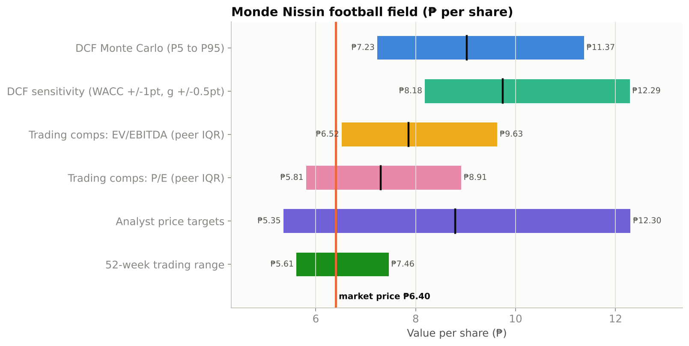

| | |
|---|---|
| **Data** | Every company figure in [`config/monde.yaml`](config/monde.yaml) carries a public source (results release and the statement it comes from, PSE EDGE disclosure, Damodaran data set, bond yield) and a date. A test fails if any number lacks one. |
| **Assumptions** | Every forecast range in [`config/monde_assumptions.yaml`](config/monde_assumptions.yaml) has a written reason, collected in [docs/ASSUMPTIONS.md](docs/ASSUMPTIONS.md). |
| **Base case** | WACC 10.24% (risk-free 6.51%, bottom-up beta 0.58, ERP 6.69%). Value ₱9.74 per share at the price date. Terminal value is 75% of enterprise value; it implies 8.3x EBITDA against a peer median of 7.8x. |
| **What matters most** | Beta, the EBITDA margin and the risk-free rate (tornado chart). The discount rate and the steady-state margin outweigh next year's growth. |
| **Reverse DCF** | Today's price implies a WACC of 14.3%, or a permanent EBITDA margin of 14.3% against 16.9% to 19.3% reported in 2023 to 2025. |
| **Excel** | `output/Monde_Nissin_DCF.xlsx`: live formulas, blue inputs, a WACC x g sensitivity table, a sources sheet. A test recalculates it in LibreOffice and checks it matches Python to the centavo. |
| **M&A** | [`accretion.py`](src/mcquant/valuation/accretion.py): accretion/dilution with breakeven synergies and a Monte Carlo on synergy delivery, on a clearly **hypothetical** deal. |

| | |
|---|---|
| 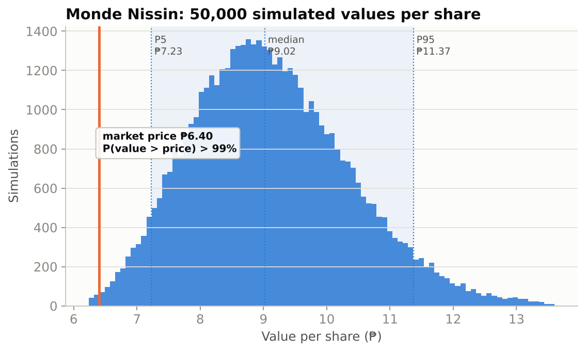 | 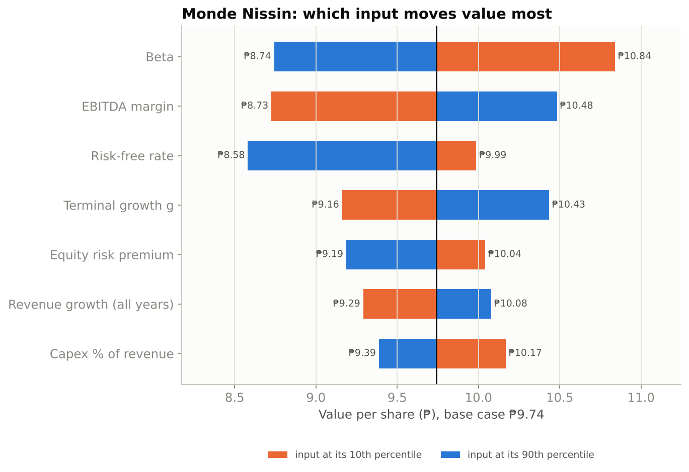 |

```bash
python scripts/run_monde_valuation.py    # writes docs/MONDE_VALUATION.md, figures and output/Monde_Nissin_DCF.xlsx
python scripts/build_assumptions_md.py   # regenerates docs/ASSUMPTIONS.md from the config
```

Full results: [docs/MONDE_VALUATION.md](docs/MONDE_VALUATION.md). Assumptions and their reasons: [docs/ASSUMPTIONS.md](docs/ASSUMPTIONS.md).

**Valuation limitations.** The ranges are judgement calls, documented but not estimated from data. Monte Carlo varies the inputs, not the model's structure. Peers are imperfect (Monde owns Quorn, a meat-alternatives business with no listed twin). The valuation date is the latest full-year balance sheet (31 Dec 2025, from the FY2025 results release), rolled forward to the price date at the cost of equity.

## Using the library

Price an option, read off the error bar, and compare with the exact answer:

```python
from mcquant import GBM, European, mc_price, bs_price, stock_control

model = GBM(s0=100, r=0.05, sigma=0.2)
res = mc_price(model, European(strike=100), T=1.0, n_paths=2**16,
               method="antithetic", seed=42, control=stock_control(model))
print(res)          # 10.4369 +/- 0.0108 (95% CI 10.4158-10.4580, antithetic+cv, n=65,536)
print(bs_price(100, 100, 1.0, 0.05, 0.2))   # 10.4506 exact, inside the interval
```

American put by Longstaff-Schwartz, checked against a tree with the same exercise dates:

```python
from mcquant import GBM, lsm_price, binomial_price

res = lsm_price(GBM(36, 0.06, 0.2), strike=40, T=1, kind="put", n_steps=50, seed=1)
tree = binomial_price(36, 40, 1, 0.06, 0.2, n_steps=2500, n_exercise=50)
print(f"LSM {res.price:.4f} +/- {res.std_error:.4f}   tree {tree:.4f}")
```

Ten-day 99% VaR of a book that holds stocks and options:

```python
import numpy as np
from mcquant import Portfolio, Position, monte_carlo_var, delta_normal_var
from mcquant.data import synthetic_market, estimate_parameters

prices = synthetic_market(seed=42)              # or load_csv("my_prices.csv")
mu, cov = estimate_parameters(prices)
spots = prices.iloc[-1].to_numpy()
book = Portfolio(spots, [
    Position(asset=0, quantity=1_000),                                        # long stock
    Position(asset=0, quantity=-1_000, instrument="call", strike=spots[0] * 1.05,
             expiry=0.25, vol=0.28),                                          # covered call
])
for rep in (delta_normal_var(book, mu, cov, 0.99, 10),
            monte_carlo_var(book, mu, cov, 0.99, 10, dist="t", df=5, seed=1)):
    print(f"{rep.method:35s} VaR {rep.var:10,.0f}   CVaR {rep.cvar:10,.0f}")
```

Real data: `pip install yfinance`, then `mcquant.data.load_yfinance(["AAPL", "JPM", "XOM"], start="2015-01-01")`. Alternatively, export any price history to a CSV with a `Date` column and pass it to `load_csv`, or upload it in the dashboard.

## How it is validated

| Check | What it guards against |
|---|---|
| MC price within 4 SE of an exact reference, for every model and contract | wrong dynamics, payoff or discounting |
| Confidence-interval coverage over 300 seeds | a mis-stated standard error (e.g. treating antithetic pairs as independent) |
| Martingale test, E[S_T] = S_0 e^{(r-q)T}, for every model and sampler | drift errors, missing jump compensator |
| Brownian-bridge covariance equals min(s, t) | errors in the QMC path construction |
| Analytic Greeks vs finite differences of the pricer | sign and scaling errors in Greeks |
| Property-based no-arbitrage bounds (Hypothesis, 200 random cases) | edge cases in Black-Scholes |
| Backtest forecasts unchanged when future data changes | look-ahead bias |
| Peak-memory budget per simulation | out-of-memory crashes on the hosted dashboard |
| Headless dashboard tests (Streamlit AppTest) for every model and contract combination | broken UI paths |

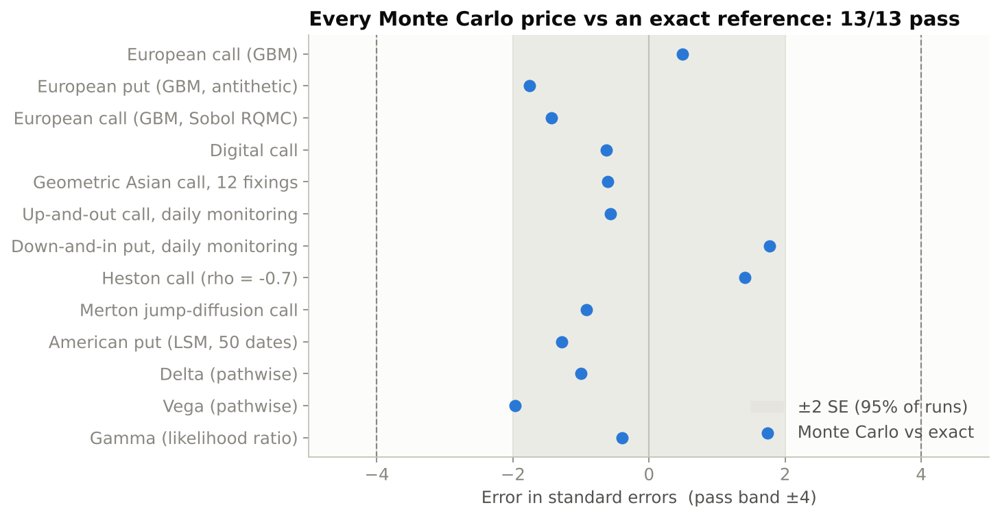

QA found and fixed 10 defects in the engine, including a double-counted discount factor in the Merton formula, a mis-fitted control-variate coefficient, and under-covering QMC confidence intervals. Each has a regression test. Details are in [docs/QA_REPORT.md](docs/QA_REPORT.md).

## Selected figures

| | |
|---|---|
| 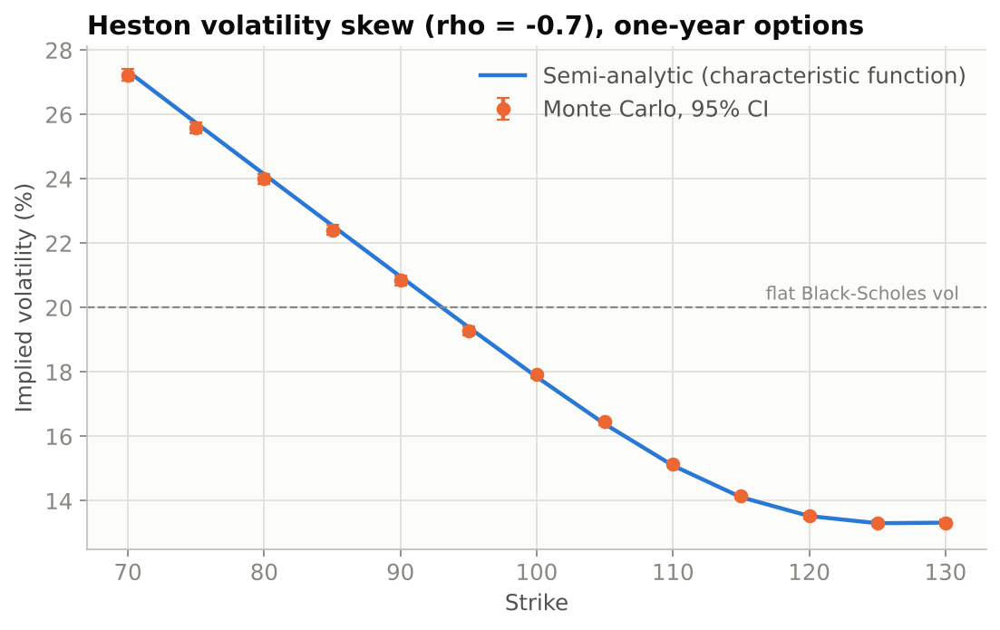 | 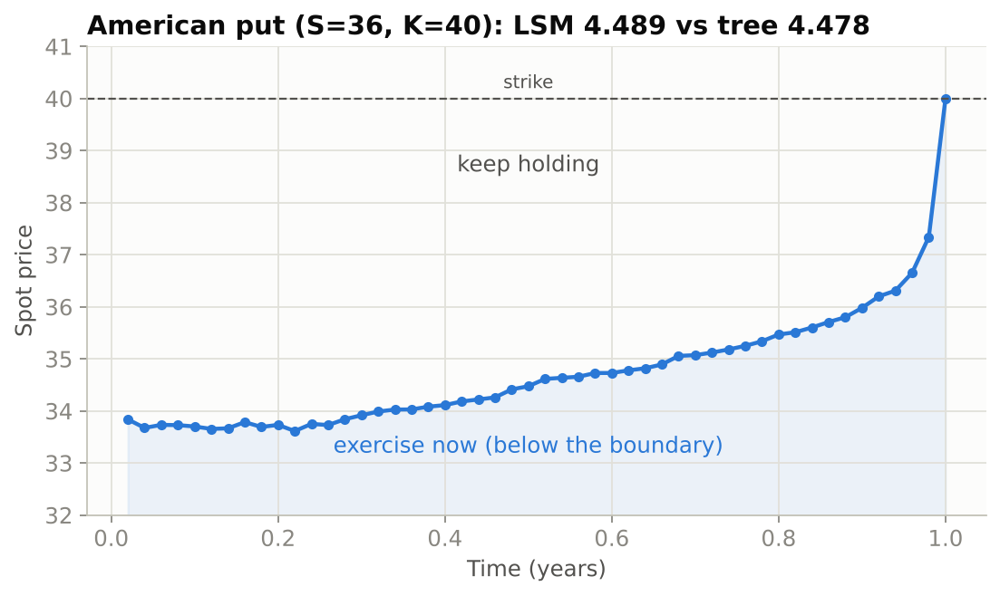 |
| 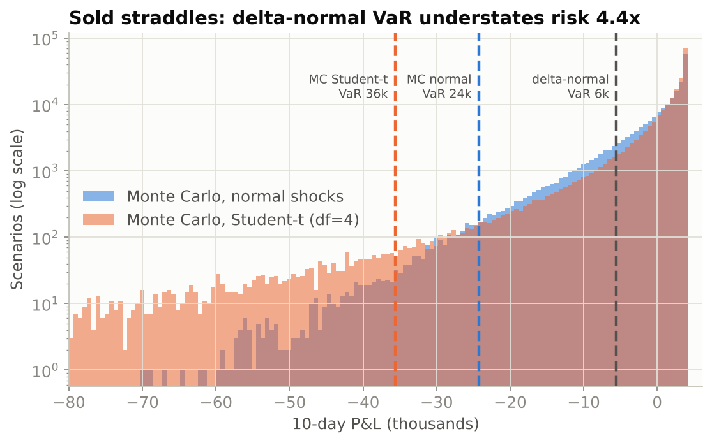 | 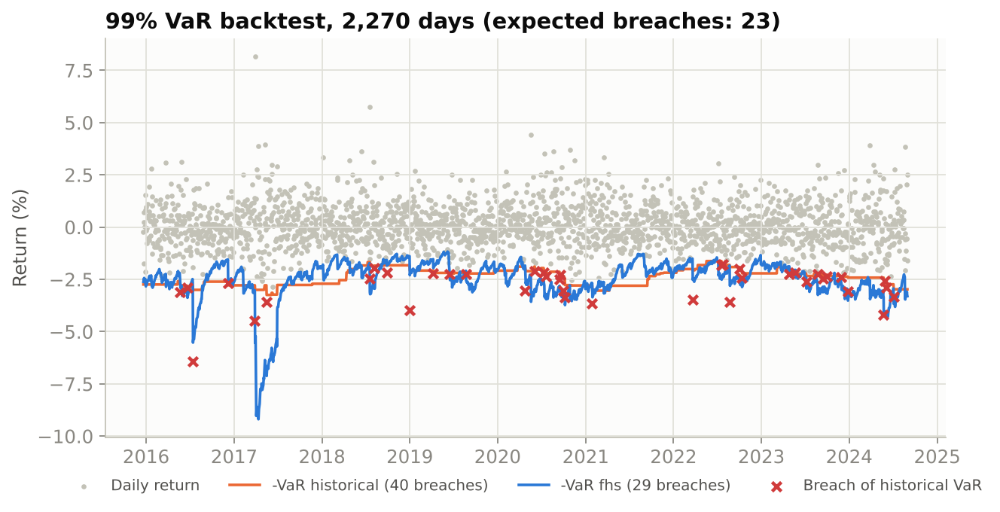 |

## Dashboard

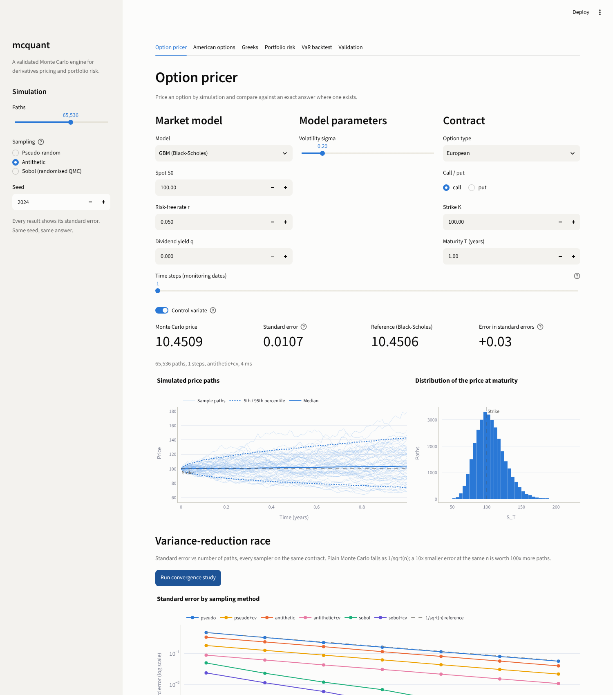

| | |
|---|---|
| 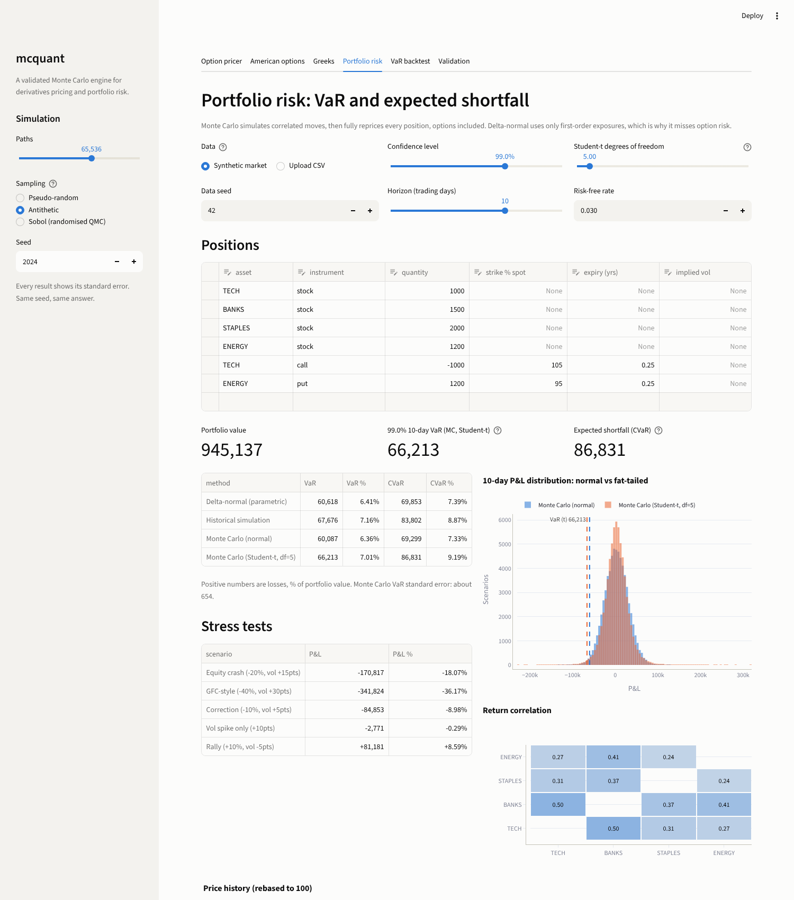 | 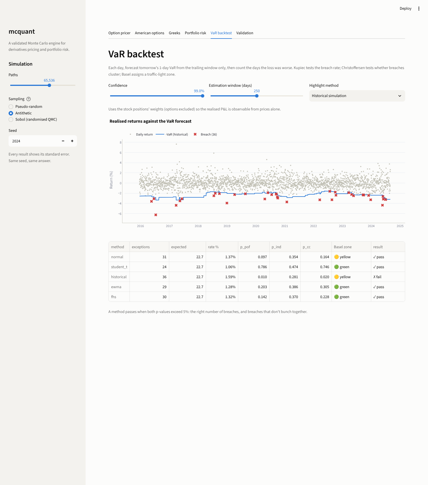 |
| 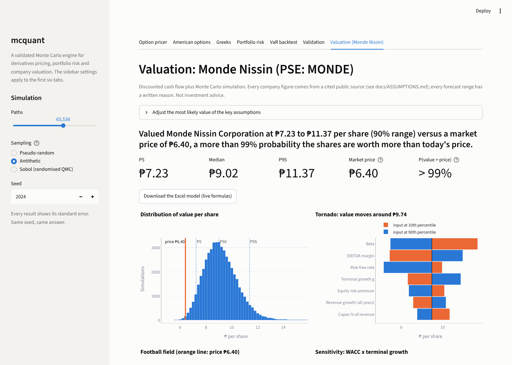 | 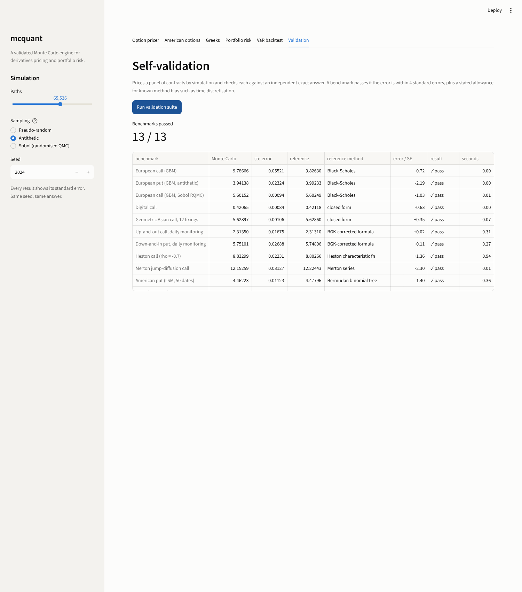 |

The seven tabs are: option pricer with a variance-reduction race, American options, Greeks, portfolio risk, VaR backtest, self-validation, and the Monde Nissin valuation (sliders for margin, terminal growth, beta, ERP and the risk-free rate, with an Excel download). To deploy it for free, push the repo to GitHub, then on [share.streamlit.io](https://share.streamlit.io) choose *New app* and point it at `app/streamlit_app.py`. `requirements.txt` is already in the repo root.

## Project layout

```
src/mcquant/
  rng.py          pseudo, antithetic and randomised-Sobol normals; Brownian bridge; correct standard errors
  models.py       GBM, Heston, Merton path simulators (memory-efficient, in-place)
  payoffs.py      European, Asian, barrier, digital
  analytic.py     Black-Scholes and Greeks, geometric Asian, barrier (+BGK), Heston CF, Merton series, CRR tree
  pricer.py       Monte Carlo pricer and control variates
  american.py     Longstaff-Schwartz (in-sample and out-of-sample)
  greeks.py       pathwise, likelihood-ratio, finite-difference-with-CRN estimators
  risk.py         portfolio revaluation, VaR/CVaR, stress tests, Kupiec/Christoffersen/Basel backtests
  data.py         GARCH(1,1)-t synthetic market, CSV and Yahoo Finance loaders
  validation.py   the 13-benchmark self-test used by the dashboard
  valuation/      inputs, wacc, dcf, montecarlo (MC DCF, tornado, sensitivity), comps, company (config loader,
                  reverse DCF), charts, excel_export, accretion
app/              Streamlit dashboard
tests/            299 tests: unit, statistical, property-based, regression, UI, docs-to-code, Excel recalculation
config/           monde.yaml (sourced facts), monde_assumptions.yaml (ranges with reasons)
scripts/          benchmarks, Monde valuation run, ASSUMPTIONS.md builder
docs/             QA_REPORT.md, MONDE_VALUATION.md, ASSUMPTIONS.md, results, figures, screenshots
```

## Design decisions

- **The standard error is computed from the independent units of each sampler.** Antithetic pairs are averaged before the variance is taken, and Sobol batches are treated as replicates, with Student-t intervals. Without this, the reported error bars are wrong.
- **Common random numbers for finite-difference Greeks.** The bumped and base prices reuse the same draws, so their difference has a small variance. Without CRN, the noise from a 1% bump swamps the signal.
- **The out-of-sample Longstaff-Schwartz estimator is the default.** Fitting the exercise rule on independent paths turns the estimate into a true lower bound with an honest standard error.
- **Full revaluation for risk.** Options are repriced in every scenario, because the gamma risk that delta-normal VaR misses is exactly what matters for an options book.
- **The memory footprint is tested.** Path matrices are built with in-place NumPy operations; Heston peak memory fell from 9x to 4x the size of the path matrix.

## Limitations and next steps

- Heston uses an Euler scheme. Andersen's QE scheme would remove most of the time-step bias at coarse grids.
- Randomised-QMC confidence intervals cover about 93-94% at the nominal 95% level. This is a known property of RQMC, and it is documented in the QA report.
- Valuation: see the limitations under [Company valuation](#company-valuation-monde-nissin).
- Ideas for extensions: Heston calibration to a market smile, local volatility, multi-asset basket options, and a GPU backend (CuPy) for the path generators.

## References

- Glasserman, P. *Monte Carlo Methods in Financial Engineering*. Springer, 2003.
- Longstaff, F. & Schwartz, E. "Valuing American Options by Simulation: A Simple Least-Squares Approach." *Review of Financial Studies*, 2001.
- Heston, S. "A Closed-Form Solution for Options with Stochastic Volatility." *Review of Financial Studies*, 1993.
- Albrecher, H. et al. "The Little Heston Trap." *Wilmott Magazine*, 2007.
- Broadie, M., Glasserman, P. & Kou, S. "A Continuity Correction for Discrete Barrier Options." *Mathematical Finance*, 1997.
- Lord, R., Koekkoek, R. & van Dijk, D. "A Comparison of Biased Simulation Schemes for Stochastic Volatility Models." *Quantitative Finance*, 2010.
- Damodaran, A. *Investment Valuation*, 3rd ed. Wiley, 2012; and country risk and industry beta data sets (January 2026).
- Koller, T., Goedhart, M. & Wessels, D. *Valuation: Measuring and Managing the Value of Companies* (McKinsey), 7th ed. Wiley, 2020.
- Kupiec, P. "Techniques for Verifying the Accuracy of Risk Measurement Models." *Journal of Derivatives*, 1995.
- Christoffersen, P. "Evaluating Interval Forecasts." *International Economic Review*, 1998.
- L'Ecuyer, P., Nakayama, M., Owen, A. & Tuffin, B. "Confidence Intervals for Randomized Quasi-Monte Carlo Estimators." 2023.

## License

MIT. See [LICENSE](LICENSE).
