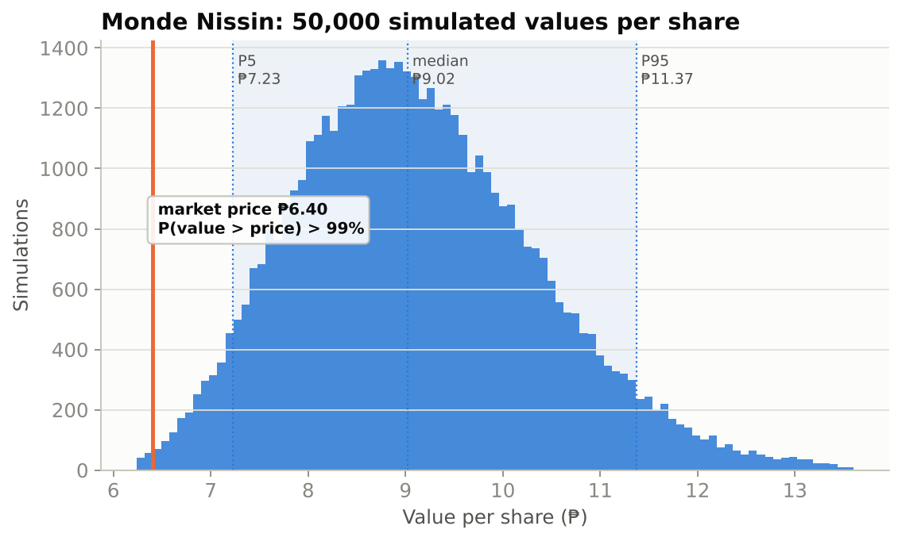
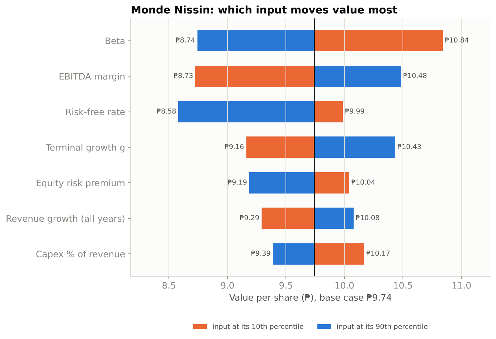
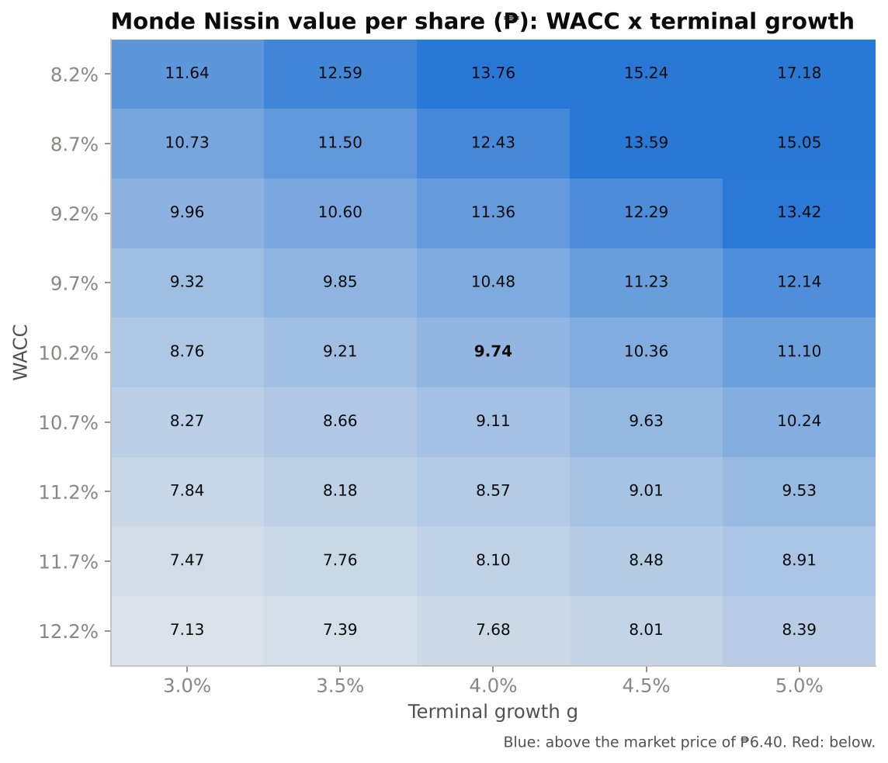
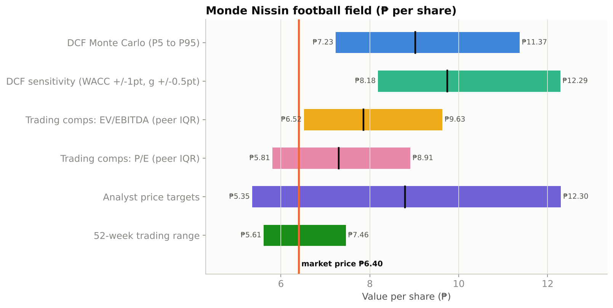

# Monde Nissin valuation: results

Generated by `scripts/run_monde_valuation.py`. Every number below comes from that run. Inputs and sources: [ASSUMPTIONS.md](ASSUMPTIONS.md).

> **Not investment advice.** This is a learning project built on public information and stated assumptions.

## Headline

> Valued Monde Nissin Corporation at ₱7.23 to ₱11.37 per share (90% range) versus a market price of ₱6.40, a more than 99% probability the shares are worth more than today's price.

## Monte Carlo summary

Value per share at the price date (2026-11-06), 50,000 simulations, seed 2026.

| Statistic | Value |
|---|---|
| P5 | ₱7.23 |
| P25 | ₱8.22 |
| Median | ₱9.02 |
| Mean | ₱9.13 (standard error ₱0.006) |
| P75 | ₱9.92 |
| P95 | ₱11.37 |
| Most-likely-inputs DCF | ₱9.74 |
| Market price | ₱6.40 |
| P(value > price) | 99.62% |
| Discarded runs (WACC - g < 1%) | 0 |

## Base case (every input at its most likely value)

### WACC

| Component | Value |
|---|---|
| Risk-free rate (10-year yield 8.134% - default spread 1.62%) | 6.514% |
| Beta (bottom-up) | 0.58 |
| Equity risk premium (Damodaran, Philippines) | 6.69% |
| Cost of equity | 10.39% |
| Pre-tax cost of debt | 9.134% |
| After-tax cost of debt | 6.85% |
| Equity weight | 95.6% |
| **WACC** | **10.24%** |

### Forecast (₱ millions)

| Year | Revenue | Growth | EBITDA | EBIT | NOPAT | Capex | Change NWC | FCFF | PV of FCFF |
|---|---|---|---|---|---|---|---|---|---|
| 2026 | 92,537 | 7.0% | 17,582 | 14,528 | 10,896 | 4,904 | 333 | 8,713 | 7,903 |
| 2027 | 98,089 | 6.0% | 18,637 | 15,400 | 11,550 | 5,199 | 305 | 9,283 | 7,638 |
| 2028 | 103,484 | 5.5% | 19,662 | 16,247 | 12,185 | 5,485 | 297 | 9,819 | 7,329 |
| 2029 | 108,658 | 5.0% | 20,645 | 17,059 | 12,794 | 5,759 | 285 | 10,337 | 6,999 |
| 2030 | 114,091 | 5.0% | 21,677 | 17,912 | 13,434 | 6,047 | 299 | 10,854 | 6,666 |

### From enterprise value to value per share (₱ millions)

| Step | ₱ millions |
|---|---|
| Sum of PV of FCFF (2026 to 2030) | 36,536 |
| PV of terminal value (g = 4.0%) | 111,106 |
| **Enterprise value** | **147,641** |
| Less debt (loans, trust receipts, leases) | (5,236) |
| Less debt-like items (dividends payable, pension) | (3,787) |
| Plus cash | 15,398 |
| Plus non-operating assets (financial assets, guaranty asset, associates) | 11,222 |
| Less minority interest | (156) |
| **Equity value** | **165,083** |
| Diluted shares (millions) | 17,968.6 |
| Value per share at 2025-12-31 | ₱9.19 |
| Rolled forward to 2026-11-06 (cost of equity 10.39%, less ₱0.24 dividend) | **₱9.74** |

The terminal value is **75%** of enterprise value. The Gordon terminal value implies an exit multiple of **8.3x** EBITDA, against a peer median of 7.8x.

## What drives the value

| Input | 10th to 90th percentile | Value at 10th | Value at 90th | Swing |
|---|---|---|---|---|
| Beta | 0.47 to 0.71 | ₱10.84 | ₱8.74 | ₱2.10 |
| EBITDA margin | 17.6% to 20.1% | ₱8.73 | ₱10.48 | ₱1.76 |
| Risk-free rate | 6.3% to 7.5% | ₱9.99 | ₱8.58 | ₱1.40 |
| Terminal growth g | 3.4% to 4.6% | ₱9.16 | ₱10.43 | ₱1.27 |
| Equity risk premium | 6.3% to 7.5% | ₱10.04 | ₱9.19 | ₱0.85 |
| Revenue growth (all years) | -1.4% to +1.0% | ₱9.29 | ₱10.08 | ₱0.79 |
| Capex % of revenue | 4.8% to 5.7% | ₱10.17 | ₱9.39 | ₱0.78 |

## What today's price implies (reverse DCF)

Holding every other input at its most likely value, the ₱6.40 price is consistent with:

- a WACC of **14.3%** (base case 10.2%), or
- a permanent EBITDA margin of **14.3%** (2023 to 2025 range: 16.9% to 19.3%), or
- perpetual growth of **-1.5%** a year after 2030 (base case 4.0%).

The market values Monde at about **6.1x** 2025 core EBITDA (market EV ₱97.6bn), below the peer median of 7.8x. Either the market expects much worse than our base case (a weaker margin, Quorn risk, higher Philippine rates), or it is too pessimistic. The Monte Carlo result says: **under our stated assumptions**, the second is likely. The reverse DCF says how wrong we would have to be.

## Cross-checks: comparable companies and the football field

| Method | Peer Q1 | Peer median | Peer Q3 | Value at Q1 | Value at median | Value at Q3 |
|---|---|---|---|---|---|---|
| EV/EBITDA | 6.3x | 7.8x | 9.8x | ₱6.52 | ₱7.86 | ₱9.63 |
| P/E | 10.8x | 13.5x | 16.5x | ₱5.81 | ₱7.30 | ₱8.91 |

EV/EBITDA uses 2025 core EBITDA (₱15.9bn) and the same equity bridge. P/E uses 2025 core EPS (₱0.54).

| Method | Low | High |
|---|---|---|
| DCF Monte Carlo (P5 to P95) | ₱7.23 | ₱11.37 |
| DCF sensitivity (WACC +/-1pt, g +/-0.5pt) | ₱8.18 | ₱12.29 |
| Trading comps: EV/EBITDA (peer IQR) | ₱6.52 | ₱9.63 |
| Trading comps: P/E (peer IQR) | ₱5.81 | ₱8.91 |
| Analyst price targets | ₱5.35 | ₱12.30 |
| 52-week trading range | ₱5.61 | ₱7.46 |

## Limitations

- **One consolidated DCF.** APAC branded food (about 84% of sales) and Quorn (meat alternatives, recently loss-making) have very different risks. A sum-of-the-parts valuation would value them separately.
- **Constant tax rate and no explicit debt schedule.** Reasonable for a company with almost no debt.
- **Data dates differ.** Financials are as of 31 December 2025, the price is 6 November 2026, and peer multiples are from September to November 2026.
- **The guaranty asset** (₱0.43 per share) is included at its carrying value, which can change.
- **The Monte Carlo probability is conditional on the input ranges.** It measures uncertainty inside the model, not the chance the model is wrong.
- **Not investment advice.**
